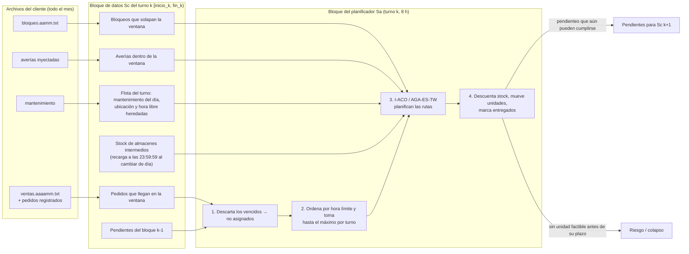
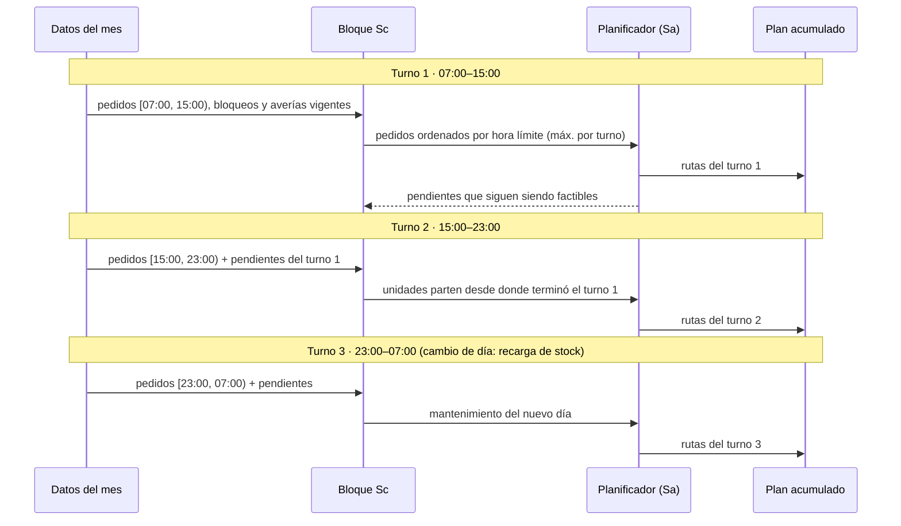
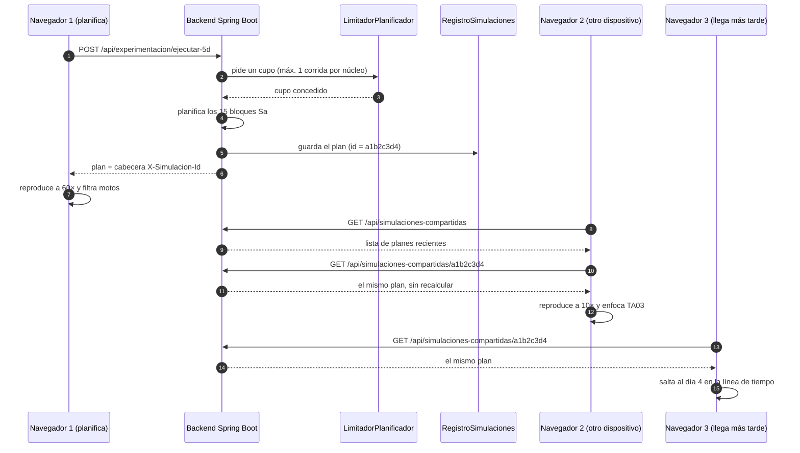

# Arquitectura de la simulación: bloques de tiempo, navegadores y seguridad

Este documento responde los puntos A22 y A23 de la rúbrica y resume cómo se
protegen el acceso y el planificador. Los diagramas usan Mermaid, que GitHub
muestra directamente.

## 1. Consumo de datos por bloques (Sc) dentro de cada bloque del planificador (Sa) — A22

El planificador no resuelve el periodo de una sola vez. Avanza por **bloques de
planificación (Sa)** de 8 horas, que coinciden con los turnos 07:00–15:00,
15:00–23:00 y 23:00–07:00. En cada Sa consume un **bloque de datos (Sc)**: lo
que llegó dentro de esa ventana más lo que quedó pendiente del bloque anterior.
Una simulación de 5 días son 15 bloques Sa; la de colapso repite bloques hasta
que algún pedido vence sin asignación.

Código: `ServicioExperimentacion.ejecutarCincoDias` y `ejecutarColapso`, un
ciclo `for (s = 0; s < numTurnos; s++)` por bloque.

Cronología de tres bloques consecutivos:

El visualizador recibe el plan acumulado de todos los bloques con el recorrido
fechado nodo a nodo y lo reproduce a la velocidad que elija el usuario: no
vuelve a consultar al backend mientras avanza el reloj.

## 2. Varios navegadores durante la simulación del periodo — A23 / G06 / C05 / C06

Un solo planificador resuelve el periodo y cualquier cantidad de navegadores,
desde distintos dispositivos y en distintos momentos, abre ese mismo plan.
Cada navegador lo reproduce con **su propio reloj, velocidad, filtros, zoom y
selección**, que viven en el estado local del navegador (Zustand). Las
consultas de uno no afectan a los demás.

- **Planificar** pasa por `LimitadorPlanificador`: como máximo una corrida por
  núcleo a la vez (configurable con `paqrap.concurrencia.ejecuciones-simultaneas`).
  Las demás esperan su turno en orden de llegada y, si esperan más de
  `espera-maxima-segundos`, reciben `503` con un mensaje en vez de colgarse.
- **Visualizar** no ejecuta el planificador: abrir un plan compartido es una
  lectura en memoria, así que muchos visualizadores no compiten por la CPU.
- Las acciones que generan respuesta del sistema (inyectar una avería,
  registrar pedidos) se envían al planificar, por lo que producen una corrida
  nueva que también queda compartida.
- En la Consola, la tarjeta **Simulaciones compartidas** lista los planes y la
  carga del planificador (corridas en curso y en espera).

## 3. Seguridad del acceso

| Control | Implementación |
|---|---|
| Autenticación | Sesión de Spring Security (`/api/auth/login`), cookie `HttpOnly` y `SameSite=Lax`, expira a los 30 min sin uso. Toda la API exige sesión (401 sin ella); `/api/admin/**` exige rol ADMIN (403). |
| CSRF | Token en cookie `XSRF-TOKEN` que el frontend reenvía en la cabecera `X-XSRF-TOKEN` en cada `POST`/`PUT`/`PATCH`. |
| Límite de intentos | `LimitadorIntentosLogin`: 5 fallos por usuario o 20 por IP en 15 min bloquean el acceso 15 min (`429` + `Retry-After`). Antes del bloqueo se avisa cuántos intentos quedan. Los usuarios inexistentes cuentan igual, para no revelar cuáles existen. |
| Contraseña segura | `PoliticaContrasena`: 12 a 72 caracteres, minúscula, mayúscula, número y símbolo, sin 4 caracteres iguales seguidos, sin el nombre de usuario y sin palabras comunes. Se exige al crear el administrador inicial y cada cuenta; el frontend muestra las reglas mientras se escribe. |
| Almacenamiento | Contraseñas con BCrypt; nunca se devuelven ni se registran. |

Pruebas automáticas: `PoliticaContrasenaTest`, `LimitadorIntentosLoginTest`,
`SeguridadLoginIT` (MockMvc sobre la cadena de filtros real) y
`LimitadorPlanificadorTest` (accesos simultáneos). Las pruebas de carga están
en [pruebas-rendimiento.md](pruebas-rendimiento.md).
